# Results summary

> Auto-generated by `ctgov_pipeline.analysis_report` after every notebook run; do not edit by hand. Every number is recomputed from `data/processed/`; figures are in `analysis/figures/`, tables in `analysis/tables/`, and the full workings in `analysis/outcome_analysis.ipynb`.

Extraction run `full_20261109_104453`, cohort rules `conditions_field_v3`; 824 included trials, 1900 primary outcome rows. Outcome categories are descriptive, rule-based aids (not the researcher's manual coding); a trial that carries several intervention or outcome categories is counted in each of them.

## 1. Main finding: Psychological & cognitive therapy flips direction depending on what it is combined with

In the full cohort, Psychological & cognitive therapy trials register a pain-interference outcome more often than a pain-recovery outcome (56% vs 42% of trials). The same holds when trials with an active non-behavioral arm are removed (58% vs 40%). In the single-category purity check the order **reverses**: pain recovery 59% vs pain interference 49% (n=39 trials).

**The same category in three versions of the intervention x outcome cross-tab** (share of the category's trials with at least one outcome of that type; a trial can have several):

| Version | Trials | Pain interference | Pain recovery |
|---|---|---|---|
| Full cohort | 173 | 56% | 42% |
| Behavioral arms only (no active non-behavioral arm) | 148 | 58% | 40% |
| Single intervention category only (purity check) | 39 | 49% | 59% |

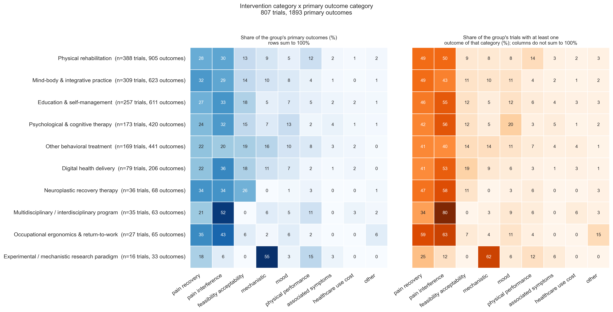

*Intervention category x outcome category, full cohort (left: share of outcomes; right: share of trials)* (PDF: `figures/fig06_intervention_x_outcome.pdf`)

*Same cross-tab restricted to trials with exactly one intervention category (purity check)* (PDF: `figures/fig06_single_category.pdf`)

### What accompanies it

175 included trials carry Psychological & cognitive therapy; only 39 (22%) carry it alone, so 78% are combined with at least one other category. The most common companions are Education & self-mgmt (42%), Physical rehabilitation (37%), Mind-body & integrative (35%). Note that the 'behavioral arms only' version does not remove these combinations (it only removes trials that add a non-behavioral arm), which is why it looks like the full cohort.

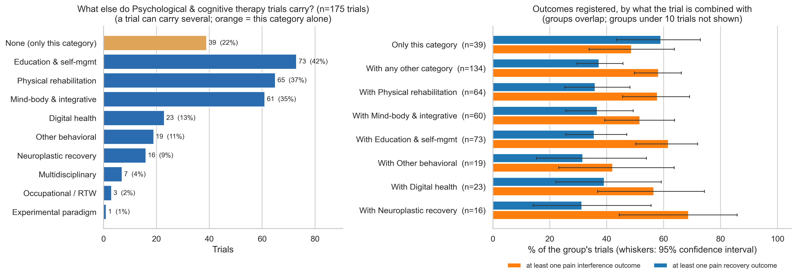

*Left: categories accompanying Psychological & cognitive therapy. Right: outcomes registered by what the trial is combined with (95% CI)* (PDF: `figures/fig15_companions_psychological_cognitive.pdf`)

### Alone versus combined

Percent of the group's trials (with a registered primary outcome) that have at least one outcome of the type; 95% Wilson confidence interval in brackets. Companion groups overlap (a trial combined with two categories appears in both rows); the first two rows do not overlap.

| Group | Trials | Pain interference | Pain recovery |
|---|---|---|---|
| Only this category | 39 | 49% (34-64%) | 59% (43-73%) |
| Combined with any other category | 134 | 58% (50-66%) | 37% (30-46%) |
| Combined with Physical rehabilitation | 64 | 58% (46-69%) | 36% (25-48%) |
| Combined with Mind-body & integrative | 60 | 52% (39-64%) | 37% (26-49%) |
| Combined with Education & self-mgmt | 73 | 62% (50-72%) | 36% (26-47%) |
| Combined with Other behavioral | 19 | 42% (23-64%) | 32% (15-54%) |
| Combined with Digital health | 23 | 57% (37-74%) | 39% (22-59%) |
| Combined with Neuroplastic recovery | 16 | 69% (44-86%) | 31% (14-56%) |

- **Pain recovery** is registered by 59% of the Psychological & cognitive therapy trials when it stands alone but 37% when it is combined (+22 points alone vs combined; Fisher exact p = 0.018).
- **Pain interference** is 49% alone and 58% combined (+9 points combined vs alone; Fisher exact p = 0.360).
- The pain-recovery shift is the larger of the two.
- Across the 6 specific companion groups (at least 10 trials) the pain-recovery share is 31-39%, below the 'alone' value in every one of them: the drop goes with being combined at all, not with one particular partner.

### Reading

The opposite trends appear to stem from composition: most Psychological & cognitive therapy trials are combined with other approaches, and the outcomes registered by combined trials lean away from pain recovery. A possible reading, which these numbers only suggest, is that Psychological & cognitive therapy on its own is more often aimed at recovering the patient (pain intensity/severity), whereas inside a combined programme the outcomes follow the other components. Limits: the 'alone' group is small (n=39; its pain-recovery share has a 95% CI of 43-73%), the comparison is exploratory (no correction for multiple comparisons), trials are not randomised to being combined or alone, and outcome categories are descriptive rule-based aids, not the researcher's manual coding.

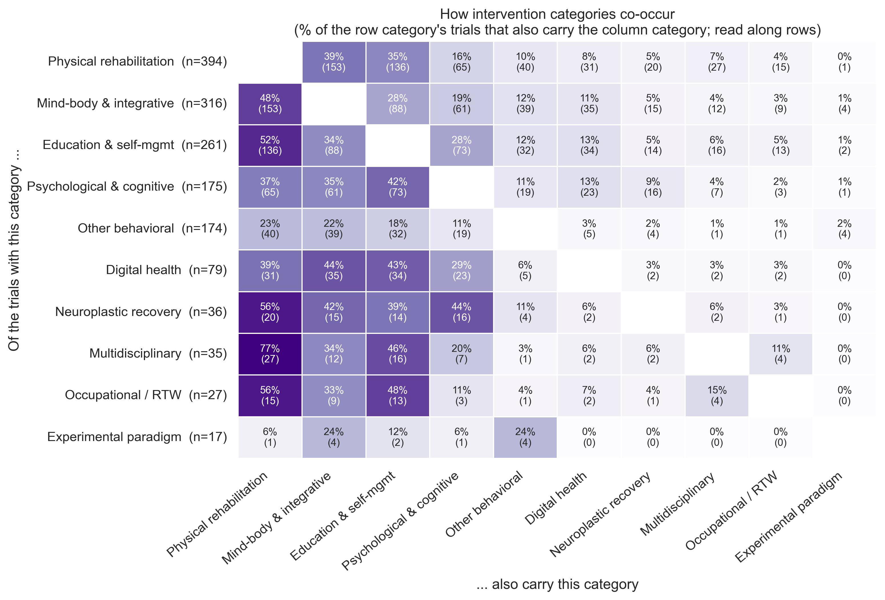

*How intervention categories co-occur (row category: % of its trials that also carry the column category)* (PDF: `figures/fig13_cooccurrence_heatmap.pdf`)

## 2. Overview of the remaining results

### 2.1 Cohort

| Metric | Value | Note |
|---|---|---|
| Master pool (before filtering) | 936 | all trials retrieved from CT.gov |
| Final analytic cohort | 824 | 88.0% of the pool |
| Excluded | 112 | 12.0% of the pool |
| Primary outcome rows (included trials) | 1,900 | one row per registered primary outcome |
| Studies with more than one primary outcome | 382 | 47.1% of the 811 included trials with a registered primary outcome |
| Mean primary outcomes per study | 2.34 | over the 811 included trials with a registered primary outcome |
| Multimodal intervention trials | 101 | 12.3% of included (behavioral + an active non-behavioral arm) |
| Included trials with no registered primary outcome | 13 | no row in primary_outcomes.csv |

Included trials were first posted between 1999 and 2026; the busiest complete year is 2025 (97 trials). The latest year is partial.

*Trials by first-post year* (PDF: `figures/fig01_trials_by_year.pdf`)

### 2.2 Exclusions

112 of 936 retrieved trials were excluded: 74 by condition eligibility, 38 by pain-character eligibility. Most frequent rules: subacute perioperative (26), acute pain (21), short pain window (17).

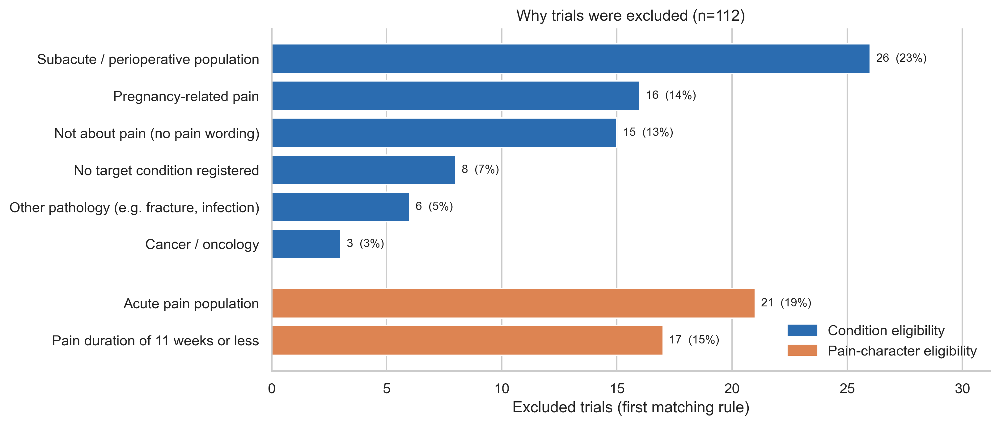

*Exclusion reasons by stratum* (PDF: `figures/fig03_exclusion_reasons.pdf`)

### 2.3 Conditions

Back pain: 423 (51%), Fibromyalgia: 212 (26%), Migraine: 139 (17%), Headache (other types): 103 (12%). 51 trials (6%) register more than one target condition, so these counts overlap.

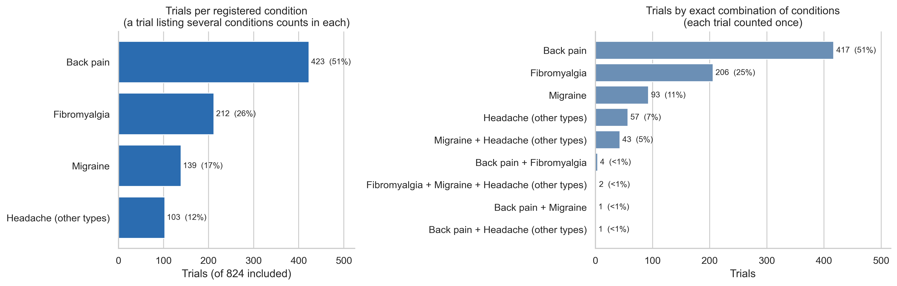

*Trials per registered condition* (PDF: `figures/fig04_conditions.pdf`)

### 2.4 Intervention categories

374 trials (45%) carry exactly one category; 101 (12%) also have an active non-behavioral arm. There are 101 distinct category combinations.

| Category | Trials | % of included | Carried alone | Most common companion |
|---|---|---|---|---|
| Physical rehabilitation | 394 | 48% | 26% | Mind-body & integrative (39%) |
| Mind-body & integrative practice | 316 | 38% | 25% | Physical rehabilitation (48%) |
| Education & self-management | 261 | 32% | 16% | Physical rehabilitation (52%) |
| Psychological & cognitive therapy | 175 | 21% | 22% | Education & self-mgmt (42%) |
| Other behavioral treatment | 174 | 21% | 44% | Physical rehabilitation (23%) |
| Digital health delivery | 79 | 10% | 14% | Mind-body & integrative (44%) |
| Neuroplastic recovery therapy | 36 | 4% | 11% | Physical rehabilitation (56%) |
| Multidisciplinary / interdisciplinary program | 35 | 4% | 14% | Physical rehabilitation (77%) |
| Occupational ergonomics & return-to-work | 27 | 3% | 22% | Physical rehabilitation (56%) |
| Experimental / mechanistic research paradigm | 17 | 2% | 41% | Mind-body & integrative (24%) |

Most common exact combinations: Physical rehabilitation (103); Mind-body & integrative (79); Other behavioral (77); Mind-body & integrative + Physical rehabilitation (67); Education & self-mgmt (43).

*Trials per intervention category and most common combinations* (PDF: `figures/fig05_interventions.pdf`)

*Most common combinations of intervention categories (UpSet plot)* (PDF: `figures/fig14_upset_combinations.pdf`)

### 2.5 Primary outcomes

1893 primary outcomes in 809 trials (outcomes labelled `not_an_outcome_measure` are left out, as in the cross-tab). Trials register 2.34 primary outcomes on average; 47% register more than one.

| Outcome category | Outcomes | % of outcomes | Trials | % of trials |
|---|---|---|---|---|
| pain recovery | 516 | 27% | 382 | 47% |
| pain interference | 516 | 27% | 374 | 46% |
| feasibility acceptability | 298 | 16% | 98 | 12% |
| mechanistic | 192 | 10% | 76 | 9% |
| mood | 140 | 7% | 86 | 11% |
| physical performance | 143 | 8% | 69 | 9% |
| associated symptoms | 38 | 2% | 25 | 3% |
| healthcare use cost | 23 | 1% | 17 | 2% |
| other | 27 | 1% | 23 | 3% |

Most frequently detected instruments: Visual Analog Scale (151), Numeric Rating Scale (121), Oswestry Disability Index (91), Fibromyalgia Impact Questionnaire (87), Brief Pain Inventory (59), Roland-Morris Disability Questionnaire (54).

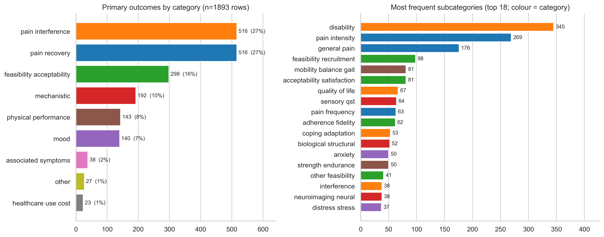

*Primary outcomes by category and most frequent subcategories* (PDF: `figures/fig07_outcome_overview.pdf`)

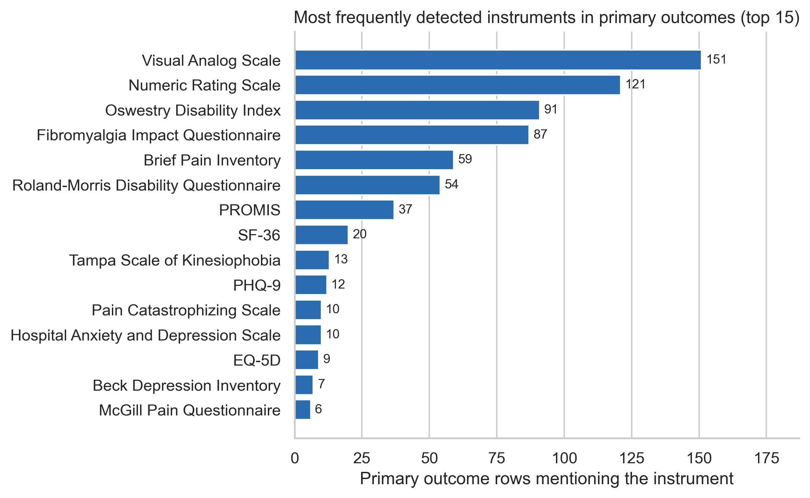

*Most frequently detected instruments* (PDF: `figures/fig11_top_instruments.pdf`)

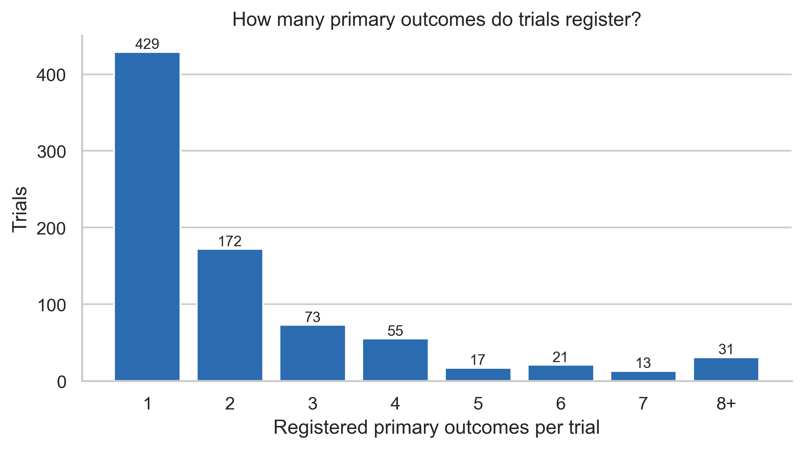

*Registered primary outcomes per trial* (PDF: `figures/fig12_outcomes_per_trial.pdf`)

### 2.6 Intervention category x outcome category (the study's main question)

Share of each category's trials that registered at least one outcome of the type (rows can exceed 100% because a trial can register several types).

| Intervention category | Trials | pain recovery | pain interference | feasibility acceptability | mechanistic | mood | physical performance | associated symptoms | healthcare use cost |
|---|---|---|---|---|---|---|---|---|---|
| Physical rehabilitation | 388 | 49% | 50% | 9% | 8% | 8% | 14% | 3% | 2% |
| Mind-body & integrative practice | 309 | 49% | 43% | 11% | 10% | 11% | 4% | 2% | 1% |
| Education & self-management | 257 | 46% | 55% | 12% | 5% | 12% | 6% | 4% | 3% |
| Psychological & cognitive therapy | 173 | 42% | 56% | 12% | 5% | 20% | 3% | 5% | 1% |
| Other behavioral treatment | 169 | 41% | 40% | 14% | 14% | 11% | 7% | 4% | 4% |
| Digital health delivery | 79 | 41% | 53% | 19% | 9% | 6% | 3% | 1% | 3% |
| Neuroplastic recovery therapy | 36 | 47% | 58% | 11% | 0% | 3% | 6% | 0% | 0% |
| Multidisciplinary / interdisciplinary program | 35 | 34% | 80% | 0% | 3% | 9% | 6% | 0% | 6% |
| Occupational ergonomics & return-to-work | 27 | 59% | 63% | 7% | 4% | 11% | 4% | 0% | 0% |
| Experimental / mechanistic research paradigm | 16 | 25% | 12% | 0% | 62% | 6% | 12% | 6% | 0% |

Most frequent clinical outcome type per category (categories with at least 10 trials; feasibility and mechanistic outcomes set aside): Physical rehabilitation: pain interference (50%); Mind-body & integrative practice: pain recovery (49%); Education & self-management: pain interference (55%); Psychological & cognitive therapy: pain interference (56%); Other behavioral treatment: pain recovery (41%); Digital health delivery: pain interference (53%); Neuroplastic recovery therapy: pain interference (58%); Multidisciplinary / interdisciplinary program: pain interference (80%); Occupational ergonomics & return-to-work: pain interference (63%); Experimental / mechanistic research paradigm: pain recovery (25%).

See the three versions of this figure in section 1; the completed-trials version is `fig06_completed`, and `fig06_custom` appears when a filter is set in the notebook.

### 2.7 Over time

Share of the period's primary outcomes by category (period = year the trial was first posted):

| Period | Outcomes | pain recovery | pain interference | mood | feasibility acceptability | mechanistic |
|---|---|---|---|---|---|---|
| up to 2009 | 122 | 34% | 39% | 8% | 7% | 3% |
| 2010-2014 | 157 | 31% | 38% | 11% | 3% | 3% |
| 2015-2019 | 420 | 28% | 29% | 8% | 15% | 9% |
| 2020-2026 | 1194 | 26% | 24% | 7% | 19% | 12% |

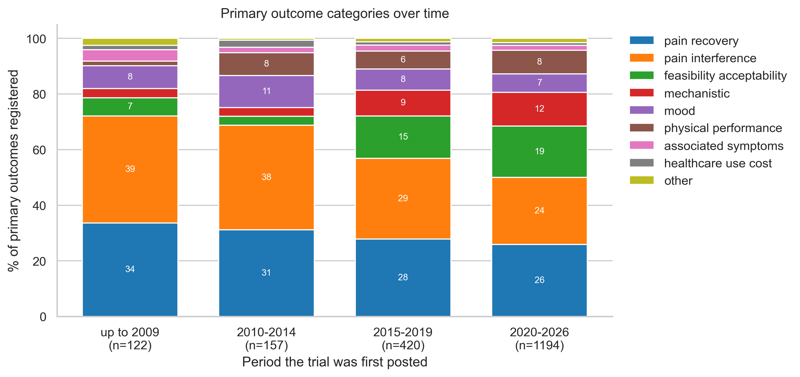

*Primary outcome categories over time* (PDF: `figures/fig08_outcomes_over_time.pdf`)

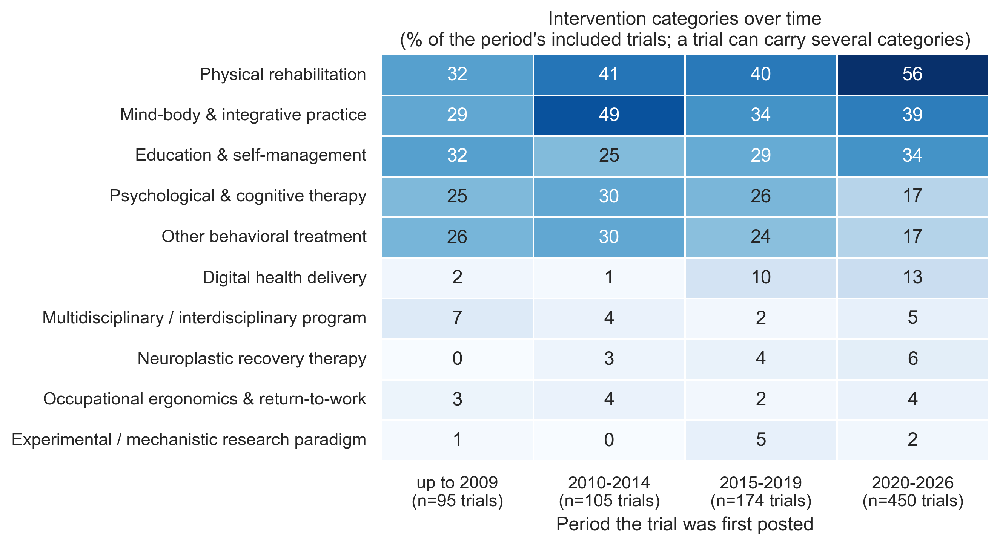

*Intervention categories over time* (PDF: `figures/fig09_interventions_over_time.pdf`)

### 2.8 Condition x outcome category

Share of each condition's trials with at least one outcome of the type:

| Condition | Trials | pain recovery | pain interference | mood |
|---|---|---|---|---|
| Back pain | 418 | 50% | 54% | 6% |
| Fibromyalgia | 206 | 33% | 46% | 23% |
| Migraine | 137 | 53% | 31% | 5% |
| Headache (other types) | 100 | 67% | 29% | 9% |

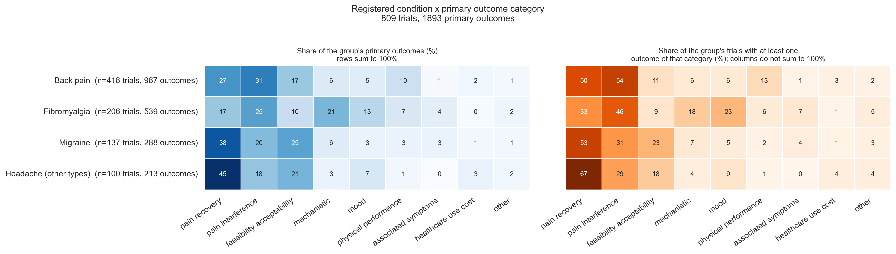

*Registered condition x primary outcome category* (PDF: `figures/fig10_condition_x_outcome.pdf`)

