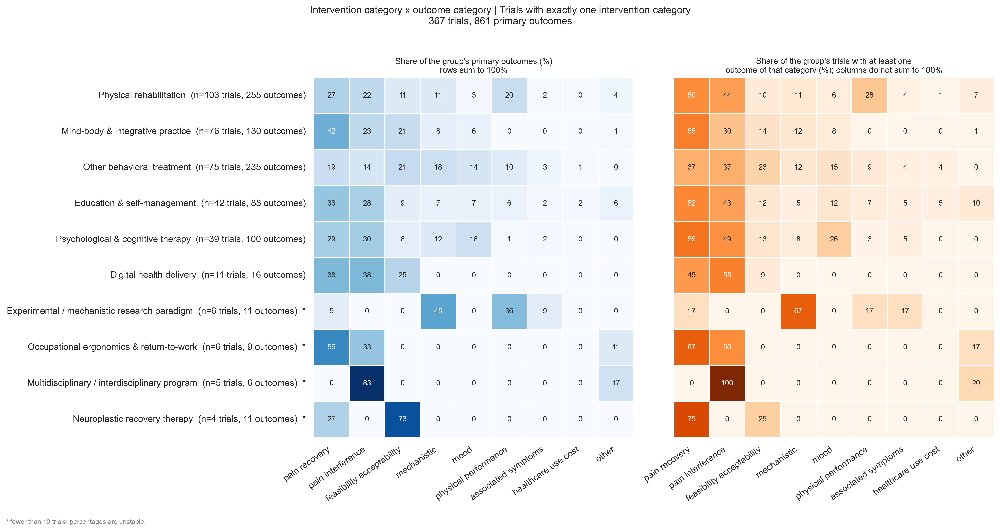
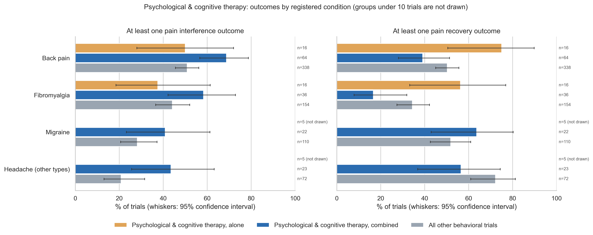
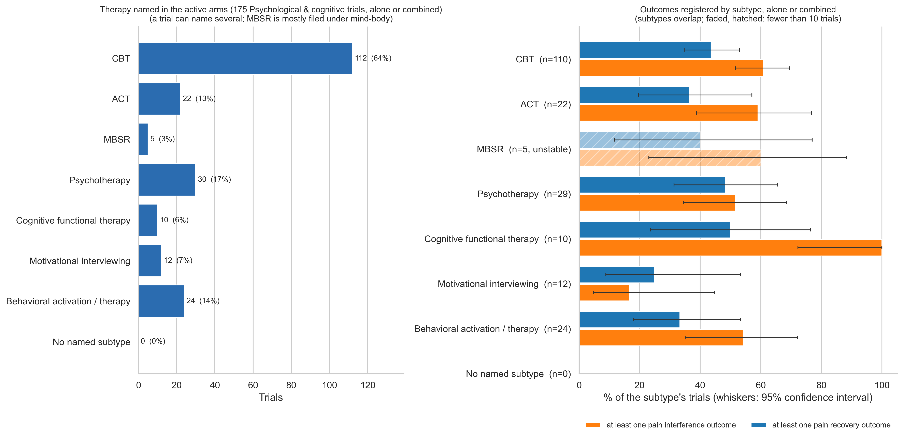
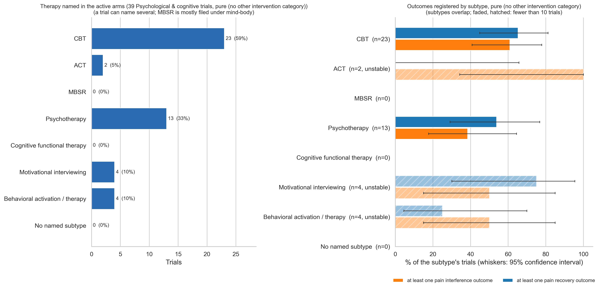
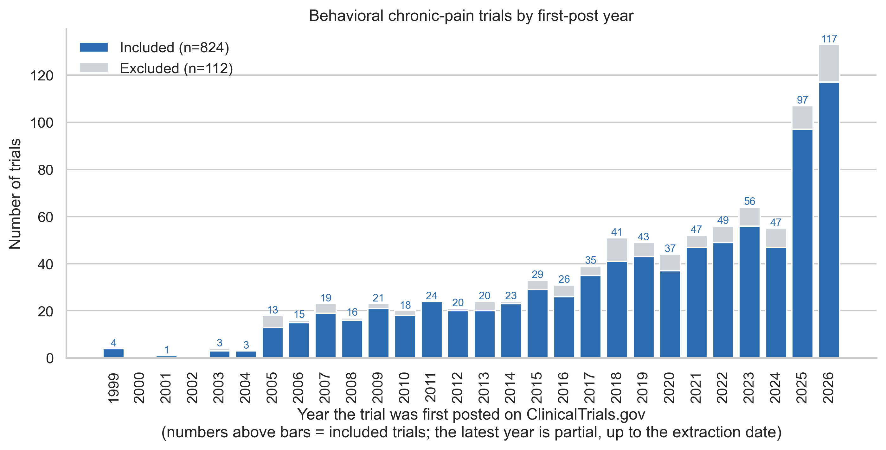
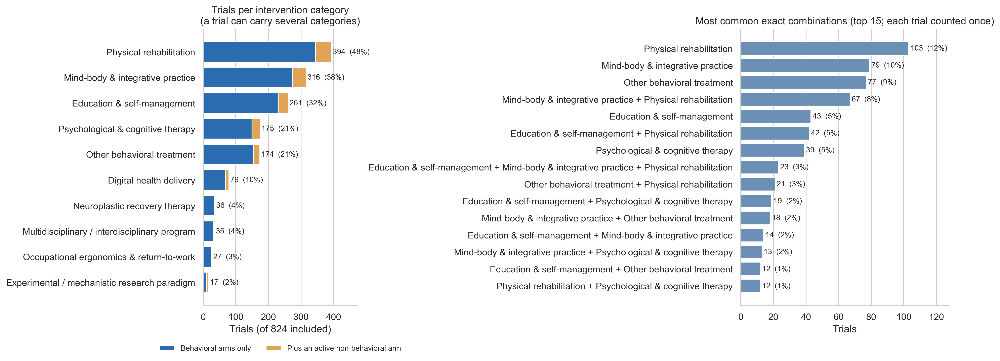
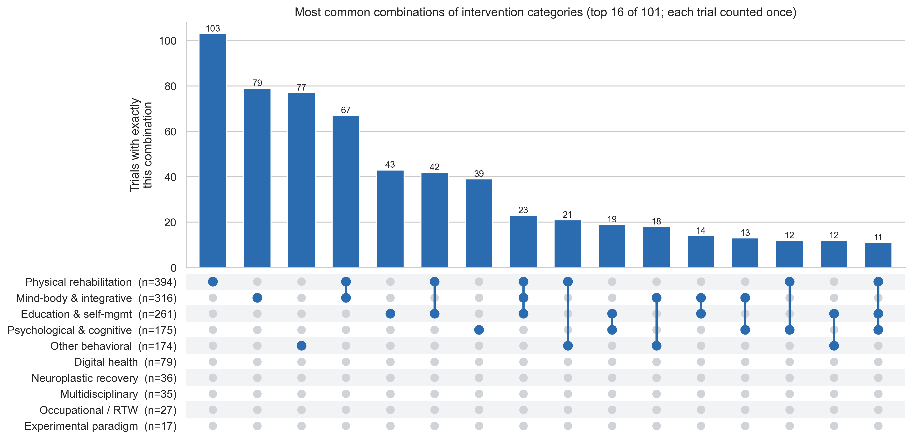

# Results summary

> Auto-generated after every notebook run; do not edit by hand. Numbers are recomputed from `data/processed/`; PDFs of the figures sit next to the PNGs; workings in `analysis/outcome_analysis.ipynb`.

Run `full_20261109_104453`, rules `conditions_field_v3`: 824 included trials, 1900 primary outcomes. Outcome categories are rule-based aids, not manual coding; a trial with several categories counts in each. Percentages are shares of trials with at least one outcome of the type.

## 1. Psychological & cognitive therapy: interference or recovery?

In the full cohort the category's trials register pain interference more often than pain recovery (56% vs 42% of trials), but in the single-category check the order **reverses** (recovery 59% vs interference 49%, n=39).

| Version (share of the category's trials) | Trials | Interference | Recovery |
|---|---|---|---|
| Full cohort | 173 | 56% | 42% |
| Behavioral arms only (no active non-behavioral arm) | 148 | 58% | 40% |
| Single intervention category only (purity check) | 39 | 49% | 59% |

### Alone or combined

175 trials carry the category, only 39 (22%) alone. Most common companions: Education & self-mgmt (42%), Physical rehabilitation (37%), Mind-body & integrative (35%).

| Group | Trials | Interference (95% CI) | Recovery (95% CI) |
|---|---|---|---|
| Alone | 39 | 49% (34-64%) | 59% (43-73%) |
| Combined | 134 | 58% (50-66%) | 37% (30-46%) |

Alone vs combined: recovery p = 0.018, interference p = 0.360 (Fisher exact, exploratory).
 Recovery is 31-39% in each of the 6 companion groups, below the 'alone' value in all of them (no single partner stands out).

**Reading.** Most Psychological & cognitive therapy trials are combined, and combined trials register recovery less often; the category may be aimed at recovery when used alone, but this is only suggested by these numbers. Caution: the 'alone' group is small (n=39), tests are uncorrected, and outcome categories are rule-based aids.

### By registered condition

*all* = alone + combined (e.g. Back pain: 80 = 16 alone + 64 combined); *other* = behavioral trials of the condition without the category. Trials per condition: Back pain 80, Fibromyalgia 52, Migraine 27, Headache (other types) 28. Full table: `tables/tab16_condition_split_psychological_cognitive.csv`.

Alone vs combined within a condition (both groups at least 10 trials):

- Back pain: recovery 75% alone vs 39% combined (p = 0.012); interference 50% vs 69%.
- Fibromyalgia: recovery 56% alone vs 17% combined (p = 0.007); interference 38% vs 58%.

Interference, all Psychological & cognitive therapy trials vs other behavioral trials: Back pain 65% vs 51%; Fibromyalgia 52% vs 44%; Migraine 44% vs 28%; Headache (other types) 50% vs 21% (higher in 4 of 4).

### Therapy subtypes within Psychological & cognitive therapy

Of 175 trials (active-arm text; a trial can name several, 37 do; MBSR is filed under mind-body, so few appear here): 112 CBT, 22 ACT, 5 MBSR, 30 Psychotherapy, 10 Cognitive functional therapy, 12 Motivational interviewing, 24 Behavioral activation / therapy, 0 No named subtype. 39 trials are pure (no other category).

| Subtype | Pure n | Pure: interf. / recov. | Combined n | Combined: interf. / recov. | Recovery, pure vs combined |
|---|---|---|---|---|---|
| CBT | 23 | 61% / 65% | 87 | 61% / 38% | p = 0.032 |
| ACT | 2 | 100% / 0% | 20 | 55% / 40% | p = 0.515 |
| MBSR | 0 | - / - | 5 | 60% / 40% | - |
| Psychotherapy | 13 | 38% / 54% | 16 | 62% / 44% | p = 0.715 |
| Cognitive functional therapy | 0 | - / - | 10 | 100% / 50% | - |
| Motivational interviewing | 4 | 50% / 75% | 8 | 0% / 0% | p = 0.018 |
| Behavioral activation / therapy | 4 | 50% / 25% | 20 | 55% / 35% | p = 1.000 |
| No named subtype | 0 | - / - | 0 | - / - | - |

Net by subtype among pure trials (trials with a recovery outcome minus trials with an interference outcome; subtypes overlap, so these do not add up): CBT +1, ACT -2, Psychotherapy +2, Motivational interviewing +1, Behavioral activation / therapy -1.

## 2. Overview of the other results

Tables behind every figure: `analysis/tables/`.

### Cohort

| Metric | Value |
|---|---|
| Master pool (before filtering) | 936 |
| Final analytic cohort | 824 |
| Excluded | 112 |
| Primary outcome rows (included trials) | 1,900 |
| Studies with more than one primary outcome | 382 |
| Mean primary outcomes per study | 2.34 |
| Multimodal intervention trials | 101 |
| Included trials with no registered primary outcome | 13 |

First posted 1999-2026; busiest complete year 2025 (97 trials).

### Exclusions

112 of 936 excluded: 74 condition eligibility, 38 pain-character eligibility; most frequent rules: subacute perioperative (26), acute pain (21), short pain window (17).

### Conditions

Back pain 423 (51%), Fibromyalgia 212 (26%), Migraine 139 (17%), Headache (other types) 103 (12%); 51 trials list more than one condition.

### Intervention categories

374 trials (45%) carry one category, 101 (12%) add a non-behavioral arm. Most common companion of each category: Physical rehabilitation with Mind-body & integrative (39%); Mind-body & integrative with Physical rehabilitation (48%); Education & self-mgmt with Physical rehabilitation (52%); Psychological & cognitive with Education & self-mgmt (42%); Other behavioral with Physical rehabilitation (23%); Digital health with Mind-body & integrative (44%); Neuroplastic recovery with Physical rehabilitation (56%); Multidisciplinary with Physical rehabilitation (77%); Occupational / RTW with Physical rehabilitation (56%); Experimental paradigm with Mind-body & integrative (24%).

### Primary outcomes

1893 outcomes in 809 trials (2.34 per trial; 47% of trials register more than one). Share of trials registering each type: pain recovery 47%, pain interference 46%, feasibility acceptability 12%, mechanistic 9%, mood 11%, physical performance 9%, associated symptoms 3%, healthcare use cost 2%. Top instruments: Visual Analog Scale (151), Numeric Rating Scale (121), Oswestry Disability Index (91), Fibromyalgia Impact Questionnaire (87), Brief Pain Inventory (59).

### Intervention category x outcome category

Most frequent clinical outcome type per category (share of its trials; feasibility and mechanistic set aside): Physical rehabilitation pain interference (50%); Mind-body & integrative practice pain recovery (49%); Education & self-management pain interference (55%); Psychological & cognitive therapy pain interference (56%); Other behavioral treatment pain recovery (41%); Digital health delivery pain interference (53%); Neuroplastic recovery therapy pain interference (58%); Multidisciplinary / interdisciplinary program pain interference (80%); Occupational ergonomics & return-to-work pain interference (63%); Experimental / mechanistic research paradigm pain recovery (25%). Figures in section 1.

### Over time

Share of outcomes, up to 2009 to 2020-2026: pain recovery 34% to 26%; pain interference 39% to 24%; feasibility acceptability 7% to 19%; mechanistic 3% to 12%.

### Condition x outcome category

Recovery / interference share of each condition's trials: Back pain 50% / 54%; Fibromyalgia 33% / 46%; Migraine 53% / 31%; Headache (other types) 67% / 29%.

