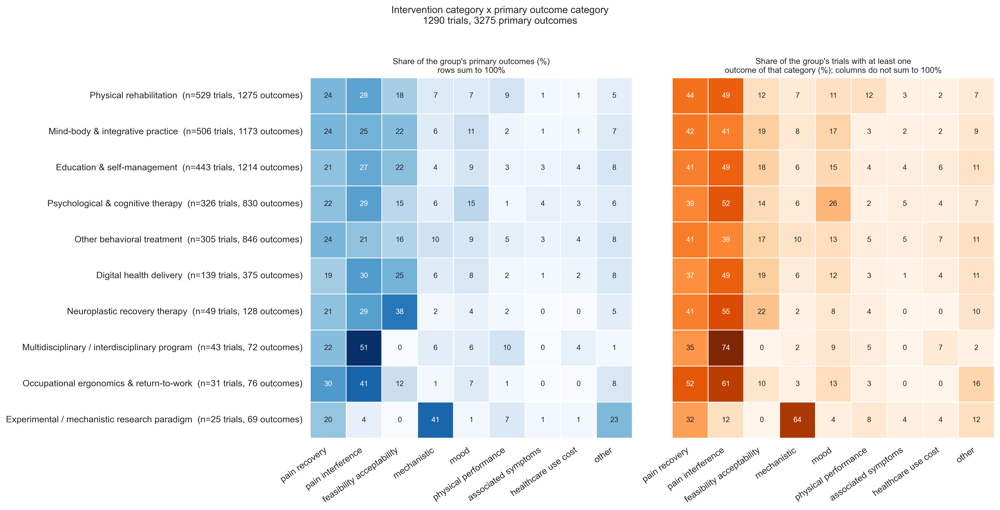
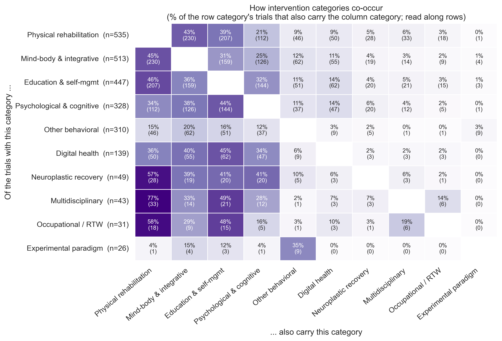
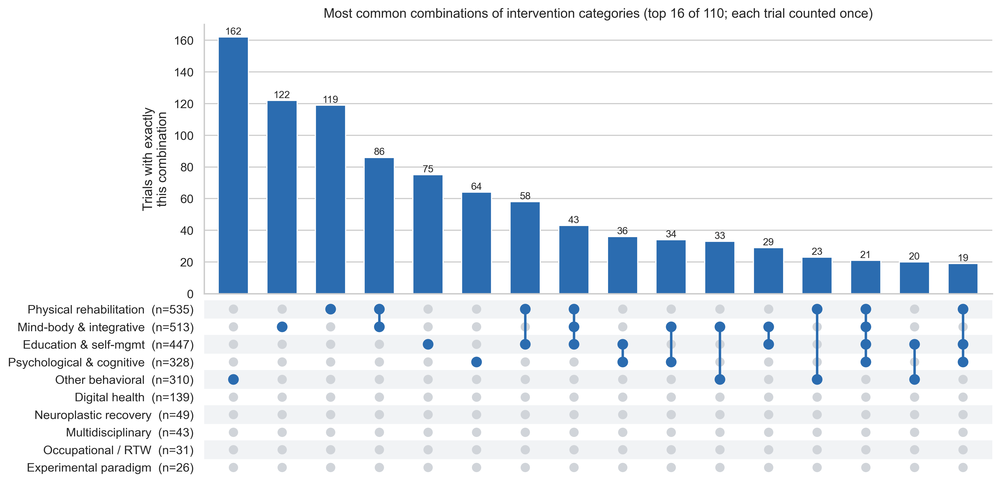
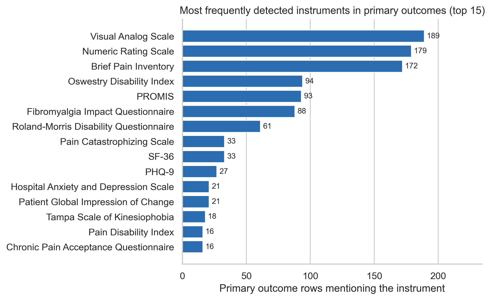
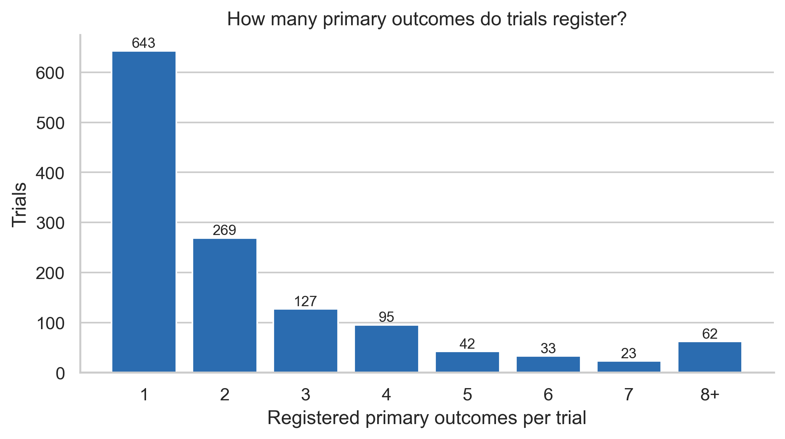
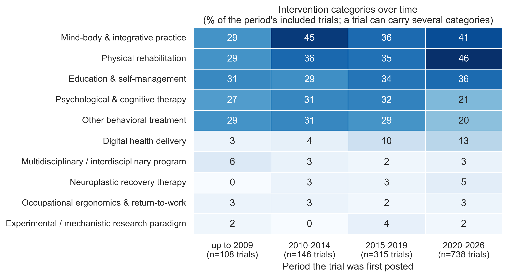
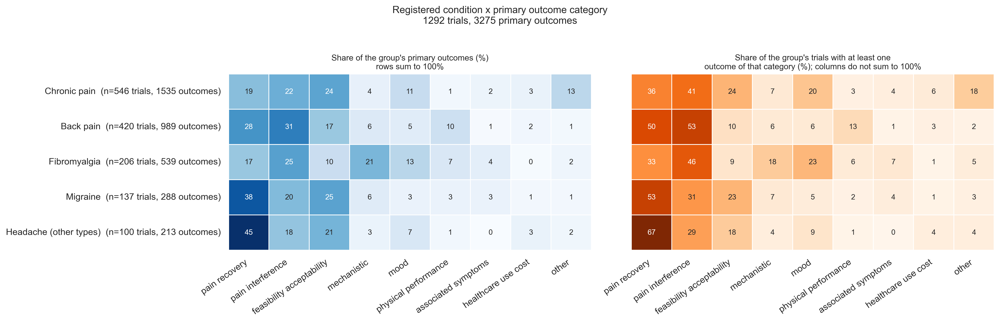

# Results summary

> Auto-generated by `ctgov_pipeline.analysis_report` after every notebook run; do not edit by hand. Every number is recomputed from `data/processed/`; figures are in `analysis/figures/`, tables in `analysis/tables/`, and the full workings in `analysis/outcome_analysis.ipynb`.

Extraction run `chronic_pain_addition_20261125_104716`, cohort rules `conditions_field_v3`; 1307 included trials, 3282 primary outcome rows. Outcome categories are descriptive, rule-based aids (not the researcher's manual coding); a trial that carries several intervention or outcome categories is counted in each of them.

## 1. Main finding: Psychological & cognitive therapy: interference and recovery outcomes

In the full cohort the shares are interference 52% and recovery 39% of the category's trials; in the single-category purity check they are 56% and 48% (n=64). The order does not reverse in this run.

**The same category in three versions of the intervention x outcome cross-tab** (share of the category's trials with at least one outcome of that type; a trial can have several):

| Version | Trials | Pain interference | Pain recovery |
|---|---|---|---|
| Full cohort | 326 | 52% | 39% |
| Behavioral arms only (no active non-behavioral arm) | 295 | 53% | 37% |
| Single intervention category only (purity check) | 64 | 56% | 48% |

*Intervention category x outcome category, full cohort (left: share of outcomes; right: share of trials)* (PDF: `figures/fig06_intervention_x_outcome.pdf`)

*Same cross-tab restricted to trials with exactly one intervention category (purity check)* (PDF: `figures/fig06_single_category.pdf`)

### What accompanies it

328 included trials carry Psychological & cognitive therapy; only 64 (20%) carry it alone, so 80% are combined with at least one other category. The most common companions are Education & self-mgmt (44%), Mind-body & integrative (38%), Physical rehabilitation (34%). Note that the 'behavioral arms only' version does not remove these combinations (it only removes trials that add a non-behavioral arm), which is why it looks like the full cohort.

*Left: categories accompanying Psychological & cognitive therapy. Right: outcomes registered by what the trial is combined with (95% CI)* (PDF: `figures/fig15_companions_psychological_cognitive.pdf`)

### Alone versus combined

Percent of the group's trials (with a registered primary outcome) that have at least one outcome of the type; 95% Wilson confidence interval in brackets. Companion groups overlap (a trial combined with two categories appears in both rows); the first two rows do not overlap.

| Group | Trials | Pain interference | Pain recovery |
|---|---|---|---|
| Only this category | 64 | 56% (44-68%) | 48% (37-60%) |
| Combined with any other category | 262 | 51% (45-57%) | 37% (31-43%) |
| Combined with Physical rehabilitation | 111 | 58% (48-66%) | 32% (24-42%) |
| Combined with Mind-body & integrative | 125 | 46% (38-55%) | 33% (25-41%) |
| Combined with Education & self-mgmt | 144 | 53% (45-61%) | 38% (31-46%) |
| Combined with Other behavioral | 37 | 46% (31-62%) | 30% (17-46%) |
| Combined with Digital health | 47 | 55% (41-69%) | 38% (26-53%) |
| Combined with Neuroplastic recovery | 20 | 60% (39-78%) | 30% (15-52%) |
| Combined with Multidisciplinary | 12 | 58% (32-81%) | 42% (19-68%) |

- **Pain recovery** is registered by 48% of the Psychological & cognitive therapy trials when it stands alone but 37% when it is combined (+12 points alone vs combined; Fisher exact p = 0.088).
- **Pain interference** is 56% alone and 51% combined (-5 points combined vs alone; Fisher exact p = 0.488).
- The pain-recovery shift is the larger of the two.
- Across the 7 specific companion groups (at least 10 trials) the pain-recovery share is 30-42%, below the 'alone' value in every one of them: the drop goes with being combined at all, not with one particular partner.

### Reading

In this run the alone-versus-combined comparison does not show a clean reversal, so no composition effect is claimed. Limits: the 'alone' group is small (n=64; its pain-recovery share has a 95% CI of 37-60%), the comparison is exploratory (no correction for multiple comparisons), trials are not randomised to being combined or alone, and outcome categories are descriptive rule-based aids, not the researcher's manual coding.

*How intervention categories co-occur (row category: % of its trials that also carry the column category)* (PDF: `figures/fig13_cooccurrence_heatmap.pdf`)

## 2. Overview of the remaining results

### 2.1 Cohort

| Metric | Value | Note |
|---|---|---|
| Master pool (before filtering) | 1,470 | all trials retrieved from CT.gov |
| Final analytic cohort | 1,307 | 88.9% of the pool |
| Excluded | 163 | 11.1% of the pool |
| Primary outcome rows (included trials) | 3,282 | one row per registered primary outcome |
| Studies with more than one primary outcome | 651 | 50.3% of the 1294 included trials with a registered primary outcome |
| Mean primary outcomes per study | 2.54 | over the 1294 included trials with a registered primary outcome |
| Multimodal intervention trials | 125 | 9.6% of included (behavioral + an active non-behavioral arm) |
| Included trials with no registered primary outcome | 13 | no row in primary_outcomes.csv |

Included trials were first posted between 1999 and 2026; the busiest complete year is 2025 (138 trials). The latest year is partial.

*Trials by first-post year* (PDF: `figures/fig01_trials_by_year.pdf`)

### 2.2 Exclusions

163 of 1470 retrieved trials were excluded: 111 by condition eligibility, 52 by pain-character eligibility. Most frequent rules: acute pain (31), subacute perioperative (27), not about pain (24).

*Exclusion reasons by stratum* (PDF: `figures/fig03_exclusion_reasons.pdf`)

### 2.3 Conditions

Chronic pain: 546 (42%), Back pain: 425 (33%), Fibromyalgia: 212 (16%), Migraine: 139 (11%), Headache (other types): 103 (8%). 112 trials (9%) register more than one target condition, so these counts overlap.

*Trials per registered condition* (PDF: `figures/fig04_conditions.pdf`)

### 2.4 Intervention categories

587 trials (45%) carry exactly one category; 125 (10%) also have an active non-behavioral arm. There are 110 distinct category combinations.

| Category | Trials | % of included | Carried alone | Most common companion |
|---|---|---|---|---|
| Physical rehabilitation | 535 | 41% | 22% | Mind-body & integrative (43%) |
| Mind-body & integrative practice | 513 | 39% | 24% | Physical rehabilitation (45%) |
| Education & self-management | 447 | 34% | 17% | Physical rehabilitation (46%) |
| Psychological & cognitive therapy | 328 | 25% | 20% | Education & self-mgmt (44%) |
| Other behavioral treatment | 310 | 24% | 52% | Mind-body & integrative (20%) |
| Digital health delivery | 139 | 11% | 12% | Education & self-mgmt (45%) |
| Neuroplastic recovery therapy | 49 | 4% | 14% | Physical rehabilitation (57%) |
| Multidisciplinary / interdisciplinary program | 43 | 3% | 12% | Physical rehabilitation (77%) |
| Occupational ergonomics & return-to-work | 31 | 2% | 19% | Physical rehabilitation (58%) |
| Experimental / mechanistic research paradigm | 26 | 2% | 38% | Other behavioral (35%) |

Most common exact combinations: Other behavioral (162); Mind-body & integrative (122); Physical rehabilitation (119); Mind-body & integrative + Physical rehabilitation (86); Education & self-mgmt (75).

*Trials per intervention category and most common combinations* (PDF: `figures/fig05_interventions.pdf`)

*Most common combinations of intervention categories (UpSet plot)* (PDF: `figures/fig14_upset_combinations.pdf`)

### 2.5 Primary outcomes

3275 primary outcomes in 1292 trials (outcomes labelled `not_an_outcome_measure` are left out, as in the cross-tab). Trials register 2.54 primary outcomes on average; 50% register more than one.

| Outcome category | Outcomes | % of outcomes | Trials | % of trials |
|---|---|---|---|---|
| pain recovery | 772 | 24% | 552 | 43% |
| pain interference | 821 | 25% | 570 | 44% |
| feasibility acceptability | 625 | 19% | 214 | 17% |
| mechanistic | 237 | 7% | 106 | 8% |
| mood | 298 | 9% | 188 | 15% |
| physical performance | 158 | 5% | 81 | 6% |
| associated symptoms | 73 | 2% | 44 | 3% |
| healthcare use cost | 73 | 2% | 48 | 4% |
| other | 218 | 7% | 118 | 9% |

Most frequently detected instruments: Visual Analog Scale (189), Numeric Rating Scale (179), Brief Pain Inventory (172), Oswestry Disability Index (94), PROMIS (93), Fibromyalgia Impact Questionnaire (88).

*Primary outcomes by category and most frequent subcategories* (PDF: `figures/fig07_outcome_overview.pdf`)

*Most frequently detected instruments* (PDF: `figures/fig11_top_instruments.pdf`)

*Registered primary outcomes per trial* (PDF: `figures/fig12_outcomes_per_trial.pdf`)

### 2.6 Intervention category x outcome category (the study's main question)

Share of each category's trials that registered at least one outcome of the type (rows can exceed 100% because a trial can register several types).

| Intervention category | Trials | pain recovery | pain interference | feasibility acceptability | mechanistic | mood | physical performance | associated symptoms | healthcare use cost |
|---|---|---|---|---|---|---|---|---|---|
| Physical rehabilitation | 529 | 44% | 49% | 12% | 7% | 11% | 12% | 3% | 2% |
| Mind-body & integrative practice | 506 | 42% | 41% | 19% | 8% | 17% | 3% | 2% | 2% |
| Education & self-management | 443 | 41% | 49% | 18% | 6% | 15% | 4% | 4% | 6% |
| Psychological & cognitive therapy | 326 | 39% | 52% | 14% | 6% | 26% | 2% | 5% | 4% |
| Other behavioral treatment | 305 | 41% | 39% | 17% | 10% | 13% | 5% | 5% | 7% |
| Digital health delivery | 139 | 37% | 49% | 19% | 6% | 12% | 3% | 1% | 4% |
| Neuroplastic recovery therapy | 49 | 41% | 55% | 22% | 2% | 8% | 4% | 0% | 0% |
| Multidisciplinary / interdisciplinary program | 43 | 35% | 74% | 0% | 2% | 9% | 5% | 0% | 7% |
| Occupational ergonomics & return-to-work | 31 | 52% | 61% | 10% | 3% | 13% | 3% | 0% | 0% |
| Experimental / mechanistic research paradigm | 25 | 32% | 12% | 0% | 64% | 4% | 8% | 4% | 4% |

Most frequent clinical outcome type per category (categories with at least 10 trials; feasibility and mechanistic outcomes set aside): Physical rehabilitation: pain interference (49%); Mind-body & integrative practice: pain recovery (42%); Education & self-management: pain interference (49%); Psychological & cognitive therapy: pain interference (52%); Other behavioral treatment: pain recovery (41%); Digital health delivery: pain interference (49%); Neuroplastic recovery therapy: pain interference (55%); Multidisciplinary / interdisciplinary program: pain interference (74%); Occupational ergonomics & return-to-work: pain interference (61%); Experimental / mechanistic research paradigm: pain recovery (32%).

See the three versions of this figure in section 1; the completed-trials version is `fig06_completed`, and `fig06_custom` appears when a filter is set in the notebook.

### 2.7 Over time

Share of the period's primary outcomes by category (period = year the trial was first posted):

| Period | Outcomes | pain recovery | pain interference | mood | feasibility acceptability | mechanistic |
|---|---|---|---|---|---|---|
| up to 2009 | 143 | 33% | 35% | 8% | 6% | 6% |
| 2010-2014 | 240 | 30% | 36% | 12% | 4% | 2% |
| 2015-2019 | 807 | 22% | 27% | 11% | 16% | 6% |
| 2020-2026 | 2085 | 23% | 22% | 8% | 23% | 8% |

*Primary outcome categories over time* (PDF: `figures/fig08_outcomes_over_time.pdf`)

*Intervention categories over time* (PDF: `figures/fig09_interventions_over_time.pdf`)

### 2.8 Condition x outcome category

Share of each condition's trials with at least one outcome of the type:

| Condition | Trials | pain recovery | pain interference | mood |
|---|---|---|---|---|
| Chronic pain | 546 | 36% | 41% | 20% |
| Back pain | 420 | 50% | 53% | 6% |
| Fibromyalgia | 206 | 33% | 46% | 23% |
| Migraine | 137 | 53% | 31% | 5% |
| Headache (other types) | 100 | 67% | 29% | 9% |

*Registered condition x primary outcome category* (PDF: `figures/fig10_condition_x_outcome.pdf`)

