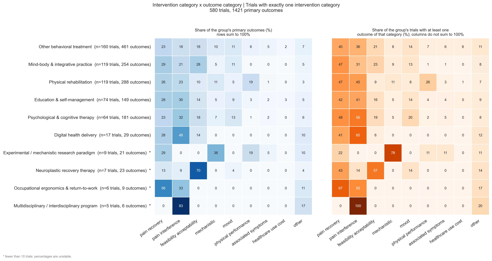
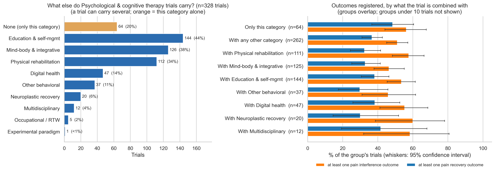
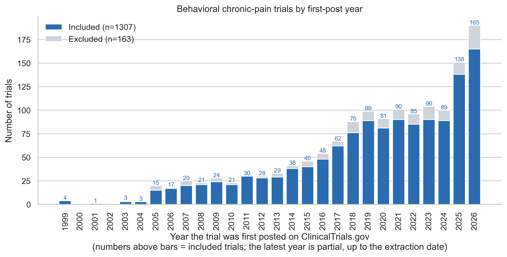
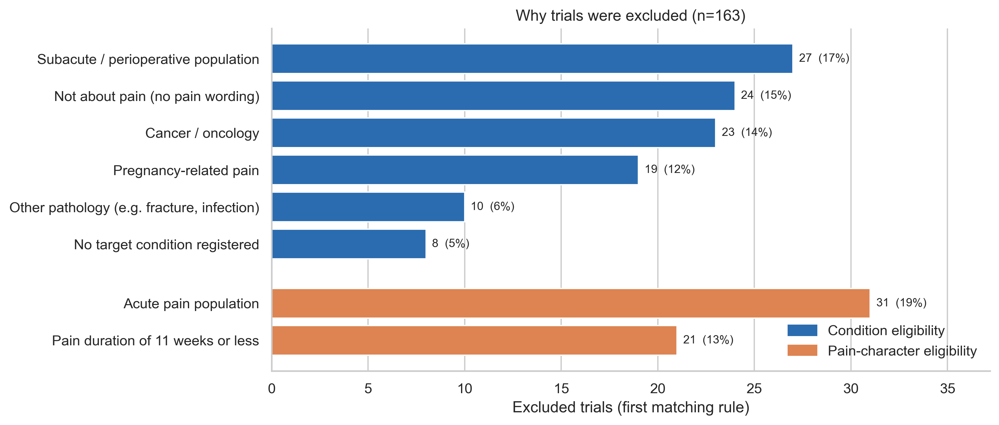
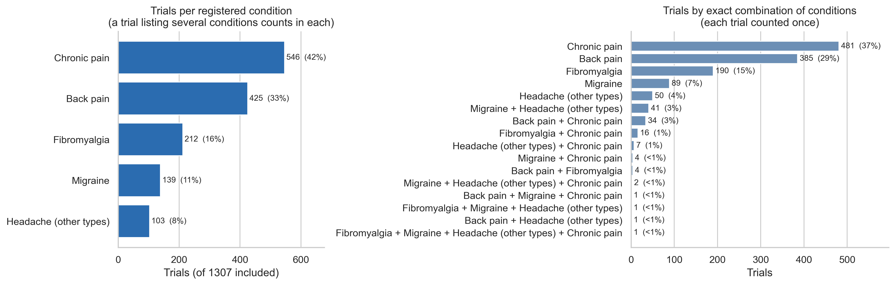
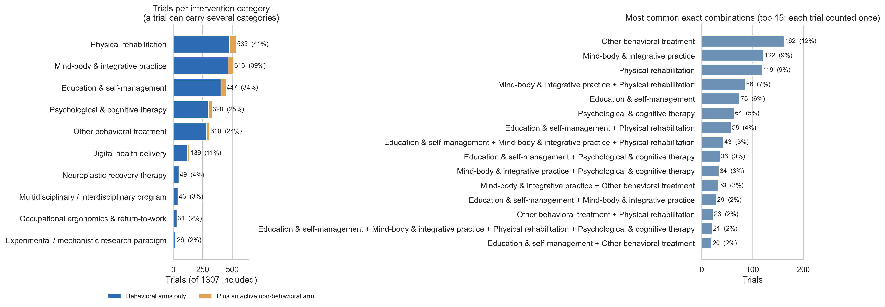

# Results summary

> Auto-generated after every notebook run; do not edit by hand. Numbers are recomputed from `data/processed/`; PDFs of the figures sit next to the PNGs; workings in `analysis/outcome_analysis.ipynb`.

Run `chronic_pain_addition_20261125_104716`, rules `conditions_field_v3`: 1307 included trials, 3282 primary outcomes. Outcome categories are rule-based aids, not manual coding; a trial with several categories counts in each. Percentages are shares of trials with at least one outcome of the type.

<!-- reproduction:start -->
## Does the main-cohort pattern reproduce with 'chronic pain' added?

The main-cohort pattern does not carry over to the trials added by the chronic-pain condition. In the main cohort, Psychological & cognitive trials used alone register recovery more often than interference (59% vs 49%, n=39) and recovery is clearly lower when they are combined (37%). Among the added trials, those used alone register interference more often than recovery (68% vs 32%, n=25) and combining makes little difference to recovery (32% alone vs 36% combined), so the alone-versus-combined recovery difference disappears (extended cohort: p = 0.09). The therapy mix also differs: psychotherapy-type trials, which drive the recovery tilt of the main cohort's pure trials, are rare among the added pure trials (4 vs 13), which are mostly CBT (13) and ACT (7), and ACT trials register interference far more than recovery. What does reproduce is the overall orientation: in both sets, combined with other intervention categories, the category registers interference at least as often as recovery (58% vs 37% in the main cohort, 44% vs 36% among the added trials), and in all five conditions it registers interference more often than other behavioral trials of the same condition. So the interference orientation of cognitive therapies holds with chronic pain included, whereas the tilt toward recovery when used alone is specific to the original four conditions (back pain and fibromyalgia, not the generic chronic-pain trials).

Tables: `comparison_with_main.md`.
<!-- reproduction:end -->

## 1. Psychological & cognitive therapy: interference or recovery?

In the full cohort the category's trials register pain interference more often than pain recovery (52% vs 39% of trials), and the single-category check gives 56% vs 48% (n=64); the order does not reverse.

| Version (share of the category's trials) | Trials | Interference | Recovery |
|---|---|---|---|
| Full cohort | 326 | 52% | 39% |
| Behavioral arms only (no active non-behavioral arm) | 295 | 53% | 37% |
| Single intervention category only (purity check) | 64 | 56% | 48% |

### Alone or combined

328 trials carry the category, only 64 (20%) alone. Most common companions: Education & self-mgmt (44%), Mind-body & integrative (38%), Physical rehabilitation (34%).

| Group | Trials | Interference (95% CI) | Recovery (95% CI) |
|---|---|---|---|
| Alone | 64 | 56% (44-68%) | 48% (37-60%) |
| Combined | 262 | 51% (45-57%) | 37% (31-43%) |

Alone vs combined: recovery p = 0.088, interference p = 0.488 (Fisher exact, exploratory).
 Recovery is 30-42% in each of the 7 companion groups, below the 'alone' value in all of them (no single partner stands out).

**Reading.** No clean alone-versus-combined reversal in this run. Caution: the 'alone' group is small (n=64), tests are uncorrected, and outcome categories are rule-based aids.

### By registered condition

*all* = alone + combined (e.g. Back pain: 80 = 16 alone + 64 combined); *other* = behavioral trials of the condition without the category. Trials per condition: Back pain 80, Fibromyalgia 52, Migraine 27, Headache (other types) 28, Chronic pain 170. Full table: `tables/tab16_condition_split_psychological_cognitive.csv`.

Alone vs combined within a condition (both groups at least 10 trials):

- Back pain: recovery 75% alone vs 39% combined (p = 0.012); interference 50% vs 69%.
- Fibromyalgia: recovery 56% alone vs 17% combined (p = 0.007); interference 38% vs 58%.
- Chronic pain: recovery 32% alone vs 36% combined (p = 0.830); interference 64% vs 46%.

Interference, all Psychological & cognitive therapy trials vs other behavioral trials: Back pain 65% vs 51%; Fibromyalgia 52% vs 44%; Migraine 44% vs 28%; Headache (other types) 50% vs 21%; Chronic pain 49% vs 37% (higher in 5 of 5).

### Therapy subtypes within Psychological & cognitive therapy

Of 328 trials (active-arm text; a trial can name several, 66 do; MBSR is filed under mind-body, so few appear here): 200 CBT, 70 ACT, 6 MBSR, 47 Psychotherapy, 12 Cognitive functional therapy, 25 Motivational interviewing, 43 Behavioral activation / therapy, 0 No named subtype. 64 trials are pure (no other category).

| Subtype | Pure n | Pure: interf. / recov. | Combined n | Combined: interf. / recov. | Recovery, pure vs combined |
|---|---|---|---|---|---|
| CBT | 36 | 61% / 53% | 162 | 48% / 42% | p = 0.268 |
| ACT | 9 | 89% / 22% | 61 | 57% / 28% | p = 1.000 |
| MBSR | 0 | - / - | 6 | 50% / 33% | - |
| Psychotherapy | 17 | 41% / 41% | 29 | 48% / 34% | p = 0.755 |
| Cognitive functional therapy | 0 | - / - | 12 | 100% / 50% | - |
| Motivational interviewing | 5 | 40% / 60% | 20 | 35% / 20% | p = 0.113 |
| Behavioral activation / therapy | 7 | 71% / 43% | 36 | 47% / 39% | p = 1.000 |
| No named subtype | 0 | - / - | 0 | - / - | - |

Net by subtype among pure trials (trials with a recovery outcome minus trials with an interference outcome; subtypes overlap, so these do not add up): CBT -3, ACT -6, Psychotherapy +0, Motivational interviewing +1, Behavioral activation / therapy -2.

## 2. Overview of the other results

Tables behind every figure: `analysis/tables/`.

### Cohort

| Metric | Value |
|---|---|
| Master pool (before filtering) | 1,470 |
| Final analytic cohort | 1,307 |
| Excluded | 163 |
| Primary outcome rows (included trials) | 3,282 |
| Studies with more than one primary outcome | 651 |
| Mean primary outcomes per study | 2.54 |
| Multimodal intervention trials | 125 |
| Included trials with no registered primary outcome | 13 |

First posted 1999-2026; busiest complete year 2025 (138 trials).

### Exclusions

163 of 1470 excluded: 111 condition eligibility, 52 pain-character eligibility; most frequent rules: acute pain (31), subacute perioperative (27), not about pain (24).

### Conditions

Chronic pain 546 (42%), Back pain 425 (33%), Fibromyalgia 212 (16%), Migraine 139 (11%), Headache (other types) 103 (8%); 112 trials list more than one condition.

### Intervention categories

587 trials (45%) carry one category, 125 (10%) add a non-behavioral arm. Most common companion of each category: Physical rehabilitation with Mind-body & integrative (43%); Mind-body & integrative with Physical rehabilitation (45%); Education & self-mgmt with Physical rehabilitation (46%); Psychological & cognitive with Education & self-mgmt (44%); Other behavioral with Mind-body & integrative (20%); Digital health with Education & self-mgmt (45%); Neuroplastic recovery with Physical rehabilitation (57%); Multidisciplinary with Physical rehabilitation (77%); Occupational / RTW with Physical rehabilitation (58%); Experimental paradigm with Other behavioral (35%).

### Primary outcomes

3275 outcomes in 1292 trials (2.54 per trial; 50% of trials register more than one). Share of trials registering each type: pain recovery 43%, pain interference 44%, feasibility acceptability 17%, mechanistic 8%, mood 15%, physical performance 6%, associated symptoms 3%, healthcare use cost 4%. Top instruments: Visual Analog Scale (189), Numeric Rating Scale (179), Brief Pain Inventory (172), Oswestry Disability Index (94), PROMIS (93).

### Intervention category x outcome category

Most frequent clinical outcome type per category (share of its trials; feasibility and mechanistic set aside): Physical rehabilitation pain interference (49%); Mind-body & integrative practice pain recovery (42%); Education & self-management pain interference (49%); Psychological & cognitive therapy pain interference (52%); Other behavioral treatment pain recovery (41%); Digital health delivery pain interference (49%); Neuroplastic recovery therapy pain interference (55%); Multidisciplinary / interdisciplinary program pain interference (74%); Occupational ergonomics & return-to-work pain interference (61%); Experimental / mechanistic research paradigm pain recovery (32%). Figures in section 1.

### Over time

Share of outcomes, up to 2009 to 2020-2026: pain recovery 33% to 23%; pain interference 35% to 22%; feasibility acceptability 6% to 23%; mechanistic 6% to 8%.

### Condition x outcome category

Recovery / interference share of each condition's trials: Chronic pain 36% / 41%; Back pain 50% / 53%; Fibromyalgia 33% / 46%; Migraine 53% / 31%; Headache (other types) 67% / 29%.

